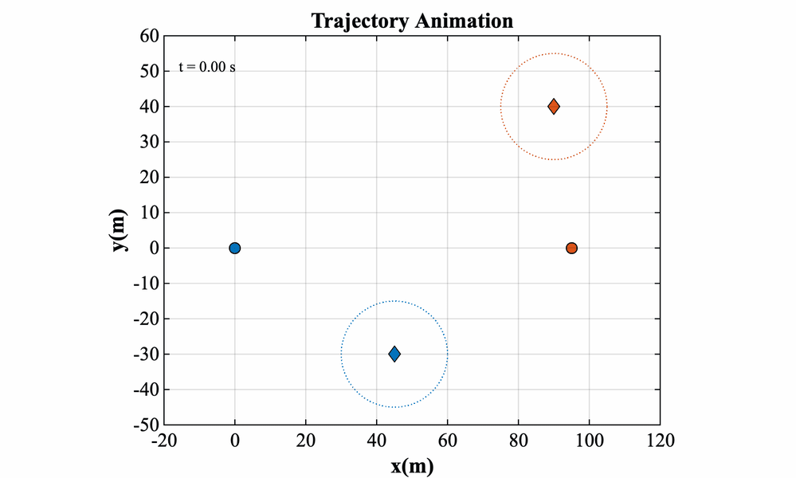
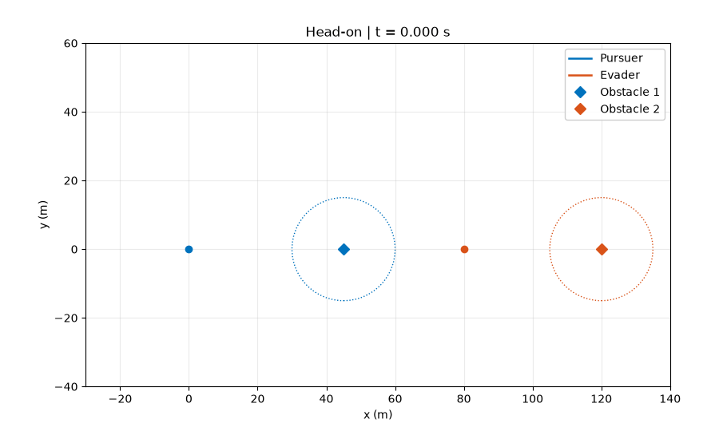
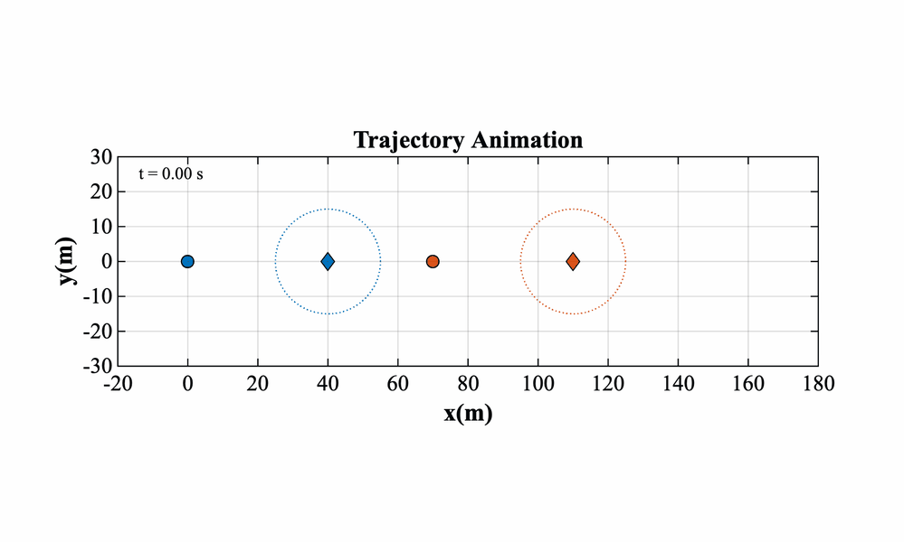
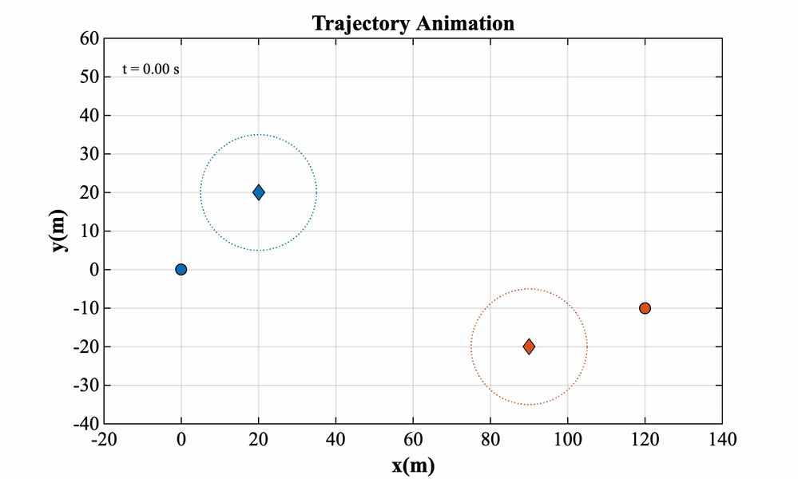
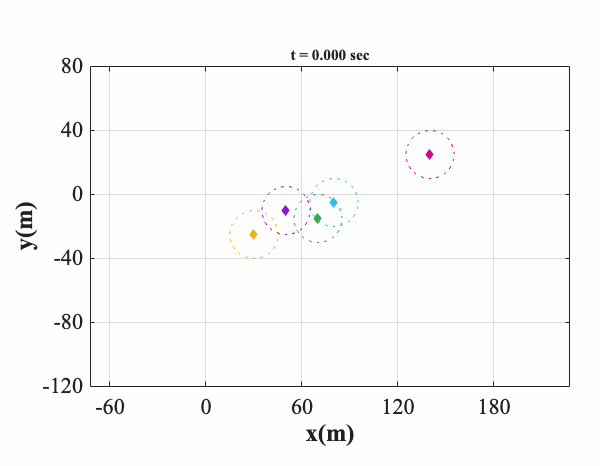

# Supplementary material

Simulation animations and figures for the pursuit-evasion study with critic-only reinforcement learning and a predictive HOCBF safety filter.

## Simulation animations

The four two-obstacle scenarios correspond to Example 1 and Figs. 2–3. The five-obstacle scenario corresponds to Example 2 and Fig. 8. All five runs use a simulation step of 0.005 s. Time labels in the animations show simulation time.

| Scenario | Capture time (s) | Animation | Trajectory figure |
|---|---:|---|---|
| Crossing | 5.5301 | [GIF](animations/Case1_Crossing_animation.gif) | [PDF](figures/Case1_Crossing_trajectory.pdf) |
| Head-on | 6.8207 | [GIF](animations/Case2_Head_on_animation.gif) | [PDF](figures/Case2_Head_on_trajectory.pdf) |
| Same-direction | 8.7257 | [GIF](animations/Case3_Same_direction_animation.gif) | [PDF](figures/Case3_Same_direction_trajectory.pdf) |
| Oblique | 6.3375 | [GIF](animations/Case4_Oblique_animation.gif) | [PDF](figures/Case4_Oblique_trajectory.pdf) |
| Five moving obstacles | 14.6574 | [GIF](animations/allin1_animation.gif) | [PDF](figures/allin1_trajectory.pdf) |

### Crossing

### Head-on

### Same-direction

### Oblique

### Five moving obstacles

## Manuscript figures

The PDF files reproduce the manuscript figure assets. PNG files provide browser previews.

| Figure | Content | Files |
|---|---|---|
| 1 | Pursuit-evasion geometry | [PNG](figures/fig1.png) |
| 2(a) / 3(a) | Crossing trajectory and obstacle distances | [Trajectory PDF](figures/Case1_Crossing_trajectory.pdf), [distance PDF](figures/Case1_Crossing_obstacle_distance.pdf) |
| 2(b) / 3(b) | Head-on trajectory and obstacle distances | [Trajectory PDF](figures/Case2_Head_on_trajectory.pdf), [distance PDF](figures/Case2_Head_on_obstacle_distance.pdf) |
| 2(c) / 3(c) | Same-direction trajectory and obstacle distances | [Trajectory PDF](figures/Case3_Same_direction_trajectory.pdf), [distance PDF](figures/Case3_Same_direction_obstacle_distance.pdf) |
| 2(d) / 3(d) | Oblique trajectory and obstacle distances | [Trajectory PDF](figures/Case4_Oblique_trajectory.pdf), [distance PDF](figures/Case4_Oblique_obstacle_distance.pdf) |
| 4 | Critic network comparison in Crossing | [PDF](figures/Case1_Crossing_pursuit_range.pdf), [PNG](figures/Case1_Crossing_pursuit_range.png) |
| 5 | HOCBF trajectory comparison | [PDF](figures/HOCBF_trajectory_comparison.pdf), [PNG](figures/HOCBF_trajectory_comparison.png) |
| 6 | Initial constraints and feasible intervals | [PDF](figures/HOCBF_initial_constraints.pdf), [PNG](figures/HOCBF_initial_constraints.png) |
| 7 | Initial feasibility maps | [PDF](figures/HOCBF_local_feasibility.pdf), [PNG](figures/HOCBF_local_feasibility.png) |
| 8 | Five-obstacle trajectory | [PDF](figures/allin1_trajectory.pdf), [PNG](figures/allin1_trajectory.png) |
| 9 | Closed-form projection geometry | [PDF](figures/allin1_proj_geometry.pdf), [PNG](figures/allin1_proj_geometry.png) |
| 10 | Projection accuracy and computation time | [PDF](figures/allin1_bench_f2.pdf), [PNG](figures/allin1_bench_f2.png) |

## File provenance

This collection follows the manuscript figure numbering as of 13 November 2026. The Head-on GIF was rendered from the saved simulation trajectory. Crossing, Same-direction, and Oblique GIFs were resized and frame-sampled for web viewing while preserving their source playback duration. The five-obstacle GIF was copied from the saved output. The PDF figures and geometry PNG were copied directly from the manuscript figure directory. Source paths and SHA-256 checksums are recorded in [the media manifest](media_manifest.json).

## Earlier supplementary animations

The original [RL animations](RL/) and [base-control animations](pure%20basecontrol/) remain available as earlier supplementary results. Their capture times and controller configurations belong to the earlier version of the study.
